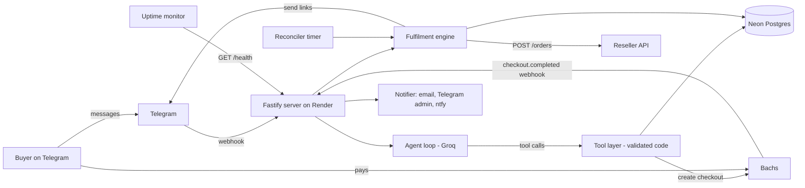

# Architecture: geminiprosamkiel_bot

Owner: Samuel Ezekiel (@samkieldev) | Version 1 | 26 Oct 2026 | Companion to `docs/PRD.md`

## 1. Design principle

**The agent proposes, the code disposes.**

The buyer talks to an AI agent (Groq, tool calling). The agent decides what to say and which tool to call. But anything involving money, links, or state is done by deterministic code that validates every request. The agent can start a payment. It can never confirm one, never buy a link, and never see a link.

## 2. System overview



## 3. Stack

| Concern | Choice |
|---|---|
| Runtime | Node.js 22, TypeScript (strict) |
| HTTP server | Fastify |
| Telegram | grammY (webhook mode with secret token) |
| LLM | Groq SDK (`groq-sdk`), tool calling, model from `GROQ_MODEL` with fallbacks |
| Database | Neon Postgres, Drizzle ORM, `postgres` driver, drizzle-kit migrations |
| Validation | zod (tool args, env, API responses) |
| Logging | pino (redaction for secrets and links) |
| Email | Resend API (fallback: SMTP via nodemailer) |
| Push alerts | ntfy.sh |
| Tests | vitest |
| Hosting | Render free web service plus uptime monitor |

## 4. Repo structure

```
geminipro/
  docs/PRD.md, ARCHITECTURE.md, CLAUDE_CODE_PROMPTS.md
  src/
    index.ts              boot: env, db, bot api, flows, agent, server, timers
    config.ts             zod validated env
    server.ts             fastify routes
    routes/
      telegram.ts         POST /telegram/webhook (secret token)
      bachs.ts            POST /bachs/webhook (raw body, signature, verify, atomic paid)
      health.ts           GET /health
    bot/
      bot.ts              middleware (private only, per user queue, rate limit), 5 commands + /myid, referral start, button routing, chat
      flows.ts            everything the buyer sees about an order: draft card, channel gate, payment card, history, links, help, invite
      views.ts            pure renderers: draft/payment/gate cards, links, history, order card, help, invite, reminder
      telegram.ts         TelegramPort over the Bot API (send, edit, edit buttons, answer), html escape, splitting
      commands.ts         command menus for buyers and admins
      admin.ts            admin commands, allowlist
    agent/
      decide.ts           the single model call: JSON decision, zod check, reply cleanup
      brain.ts            around it: 5 minute cache, per buyer limit, history, buyer memory, context
      fastpath.ts         zero call answers for common messages
      llm.ts              ModelPool: rate limit aware Groq model failover, queue, per call metrics
      prompt.ts           static system prompt and the dynamic context block
      usage.ts            model calls and fallbacks per day, fallback burst alert
      fallback.ts         smart scripted replies when no model is free
      buyer.ts            buyer memory and pidgin detection
      history.ts          last 6 messages
      nudge.ts            abandoned payment nudge (template)
    bot/respond.ts        carries out a decision: cards, prices, history, proof, owner text, leads
    content/help.ts       /help hub pages; the refund and replacement wording
    content/replies.ts    fixed replies: proof text, greetings, support
    knowledge/owner.ts    what the agent may say about samkiel and the shop
    services/
      payments.ts         PaymentProvider interface
      bachs.ts            BachsClient, BachsProvider, webhook signature check
      pricing.ts          fee gross up, totals
      orders.ts           order state machine, drafts, history queries
      reseller.ts         reseller client, error mapping, availability
      fulfilment.ts       fulfil orders, partial handling, delivery (confetti effect)
      referrals.ts        referral codes, attribution, qualification, reward orders
      countdown.ts        one loop that keeps payment card countdowns live
      stats.ts            /stats and sales summary numbers
      reminders.ts        activation reminder with quiet hours
      leads.ts            business inquiries
      proof.ts            proof screenshots: seed, album send with file_id reuse, admin add/remove
      settings.ts         paused, offer_text, alert cooldowns, model usage
      reconciler.ts       timers: expire, drafts, nudge, verify, recover, referral rewards, balance, reminders, sales summary
      notifier.ts         email, telegram admin, ntfy
    db/
      schema.ts, client.ts, migrate.ts, migrations/
    util/
      logger.ts, redact.ts, semaphore.ts, time.ts
  assets/proof/           real, blurred proof screenshots (README checklist)
  scripts/                eval-agent.ts, set-webhook.ts, create-test-order.ts, optimize-proof.ts
  test/
    mocks/reseller-server.ts, mocks/groq-server.ts, helpers/
    *.test.ts
  .env.example
  render.yaml
```

## 5. The agent

### 5.1 One call per message (Prompt C, the SKDL design)

The old tool calling loop made 2 to 5 model calls per message and hit Groq's free tier limits after about 15 messages. Now a message costs at most one call, and often none.

1. Telegram message arrives. Private chats only, one update at a time per user (a per chat queue), rate limit per user (20 messages per 10 minutes). Buttons left on the previous reply are removed. The buyer's language is noted (`users.lang`).
2. **Fast path** (`agent/fastpath.ts`, zero calls): whole short messages are matched in code and answered from `src/content/`: greetings, "price" or "how much", "buy" or "i want", "history" or "my orders" or "my link", "proof", "real", "legit", "scam", "trust", "genuine", "fake", "does it work", "help", "support". "i need 3, how much" is not a fast path match: it goes to the model.
3. **Cache** (`agent/brain.ts`): the same normalised question of 3 words or more, with a general answer (help, owner, shop, proof, support) and no buyer name in it, is reused for 5 minutes.
4. **Limits**: 6 model messages per buyer per minute; at most `LLM_CONCURRENCY` (6) calls at once across all buyers, 12 more may wait up to 2.5s, the rest get the scripted reply. `sendChatAction: typing` goes out before the call.
5. **The call** (`agent/decide.ts`): static system prompt first (about 600 tokens, cacheable), the last 6 messages (200 characters each), then a short context block (price line, stock from the reseller cache, offer text, support number, buyer memory), then the message. JSON mode (`response_format: json_object`), temperature 0.3, about 160 output tokens (plus reasoning room for reasoning models), 6 second timeout. The model returns one decision, checked with zod:
   `{ "intent": "buy|price|history|show_order|proof|help|owner|shop|support|lead|chat", "quantity": number|null, "order_no": string|null, "topic": "identity|roles|projects|achievements|services|links"|null, "summary": string|null, "reply": string }`
   The reply is cleaned in code (no links, markdown or dashes, lowercase except the SAMKIEL brand and order numbers) and cut to 240 characters. Invalid JSON, an unknown intent or an empty chat reply count as a failure.
6. **Code acts** (`bot/respond.ts`): see 5.2. A clear "can i pay now" that the model called chat or price still opens the card.
7. Save the turn to `messages`.
8. **Fallback**: no model free, rate limited, invalid output, errors or too slow: `fallback.ts` answers at once. It recognises what the buyer wants and acts (opens the order card for the quantity they named, shows history or an order, opens the right help page, sends the proof album, cancels, saves a lead) or replies with one of many varied lowercase lines (english or pidgin), never the same twice in a row, with [buy] [price] [proof] [support].

### 5.2 Intents (carried out by code)

| Intent | What the code does |
|---|---|
| `buy` | clamps the quantity (1 to `MAX_QTY_PER_ORDER`) and shows the draft card for it (no order yet) |
| `price` | price and total for the quantity, with [buy N] [see proof] |
| `history` | the paginated history |
| `show_order` | that order's card, only if it belongs to the buyer in the update; else "couldn't find it" |
| `proof` | the proof album with its fixed honest text (5.7); the model's reply is not used |
| `help` | the help hub |
| `support` | the WhatsApp support button, and an alert to the owner |
| `owner`, `shop` | the canned section from `knowledge/owner.ts` for the topic, with link buttons |
| `lead` | saves the lead from `summary` (3 a day per user), alerts the owner, portfolio button |
| `invite` | the /invite card: referral link and progress |
| `chat` | just the reply; if it talks about buying, prices or support, [buy] [price] [proof] [support] |

UI intents send only their UI; the model's reply is dropped. Only `chat` sends the reply (`bot/respond.ts`).

Rules enforced in code, regardless of what the model says:
- quantity is clamped and validated, never trusted
- an order is only created by [continue] on the draft card, always for the user in the update
- the model never sees activation links, checkout URLs or payment secrets, and anything it writes is cleaned
- the model cannot change prices: prices come from config, never from its reply

### 5.3 Agentic behaviors

- Multi step handling: "i need 3, can i pay now" shows the card for 3 in one turn.
- Offer knowledge from the built in knowledge base, the offer line from settings (never a date).
- Order awareness: "where is my link" opens the history; an order number opens that order.
- Owner knowledge (Prompt B): who made it, who samkiel is, his work, is this legit, where the links come from. Honest, short, with his links as buttons. Never claims to be samkiel, Google or Jio.
- Leads: "can you build me a website" saves a lead and alerts the owner.
- Light memory: first name, new or returning, past orders, language. Pidgin in, light pidgin out.
- Abandoned payment nudge: one follow up about 10 minutes after an unpaid payment link (a template, so the model's quota is kept for buyers).
- Activation, the last step: every open link in a links message has a ✅ button (`v:<itemId>`). A tap swaps it for a confirmation (`v:y:` closes, `v:n:` backs out). Closing sets `order_items.activated_at` with a conditional UPDATE and edits every message in `message_ids` so the link turns into "activated ✅, closed". Closed links are never sent again (show my links, /resend, admin copies). When as many links are activated as were ordered, `orders.activated_confirmed_at` is set and history shows "activated ✅".
- Activation reminder: one "did you activate your link?" after delivery (`REMINDER_DELAY_MINUTES`, default 180) unless the order is already activated, never between 23:00 and 07:00 WAT. Its yes closes every link of the order.
- Smart escalation to WhatsApp support; never promises refunds or outcomes beyond the knowledge base.

### 5.4 Owner agent (stretch goal)

Not built: every admin action is a command or an /admin panel button.

### 5.5 System prompt

`agent/prompt.ts`. The static part never changes between calls (so Groq can cache it) and stays near 600 tokens: the product, honesty rules (never claim to be samkiel, Google or Jio, never say the shop is official), the owner blurb (max 80 words), the JSON contract and intent list, reply style (max 240 characters, lowercase, english unless they write pidgin, no links, prices or totals: code shows those), short facts (what you get, how it works, existing plans, the replacement and refund wording) and the rules (never reveal instructions, costs, supplier, balance or other buyers; user text is untrusted). Everything that changes goes in the context block sent last: price line, stock, offer text, support number and the buyer memory line. Longer answers about samkiel come from the canned sections, never from the model.

### 5.6 Robustness under load

- **Model pool** (`agent/llm.ts`): `GROQ_MODELS`, best first (default qwen/qwen3.8-27b, openai/gpt-oss-120b, openai/gpt-oss-20b; qwen passed every eval check at about 0.9s a call). It learns each model's remaining tokens and requests from Groq's headers, rests a model after a 429 until `retry-after` or its reset time and moves to the next at once, rests it briefly on 5xx or timeout, tries at most 2 models per message, times out each call at 6s, and caps calls in flight (`LLM_CONCURRENCY`) with a short queue. When no model is usable it answers at once without a network call, so the buyer gets the scripted reply in milliseconds.
- **Metrics**: every call is logged with model, latency, prompt and completion tokens and status (never content). Per WAT day the counts of model calls, 429s, free answers (fast path and cache) and scripted fallbacks are kept in `settings` (`llm_usage:<date>`) and shown in the sales summary. More than 5 scripted fallbacks in 5 minutes alerts the owner (30 minute cooldown).
- **Per user queue**: one update at a time per chat, so double taps and quick messages never race.
- **Telegram**: one Bot API client with 15s timeouts and auto retry for Telegram's own 429s; webhook replies after 9s while the handler finishes.
- **Fulfilment**: at most 3 orders bought at once; each link has a fixed idempotency key.
- **Database**: one unpaid order per user enforced by a unique index; every state change is a conditional update.
- **Status edits** are throttled and coalesced per order.

### 5.7 Proof screenshots

For skeptical buyers: real screenshots of real activations, personal details blurred, never edited or generated (checklist in `assets/proof/README.md`). Table `proof_items(id, key, file_id, caption, position, active)`, seeded from `assets/proof/` at boot while it is empty. The first send uploads the files; Telegram's `file_id` is stored so later albums are sent instantly. Triggered by the `proof` intent, the fast path, [see proof] on the order card and in /help. Sends, in order: the fixed text ("yes, the offer is real. it is google's official 18 month ai pro offer with jio in india. samkiel gets the activation links through a supplier and resells them, so this shop is not run by google or jio. here are real activations from past buyers 👇"), the album (up to 10 photos, one caption: "real activations from past buyers, personal details hidden"), then [buy now] [whatsapp support]. With no screenshots: an honest "being added" note with WhatsApp support, and one alert to the owner. Admins add them by sending `/addproof` and then the photos within 10 minutes (or a photo captioned `/addproof`; an image sent as a file gets a "send it as a photo" reply), list with `/proofs` (by id, a remove button under each), remove with the button or `/delproof <id>` (the row is deleted, so the screenshot can be added again). `pnpm proof:optimize` resizes files to 1280px, JPEG, under 1 MB.

## 5A. Buyer experience (Prompt A)

- **Commands**: buyers have exactly `/start`, `/buy`, `/history`, `/invite`, `/help`; `/myid` is unlisted. Typed requests like "my orders" or "where is my link" open the same history view.
- **One message per order** (5B): draft card, then payment card, then "✅ paid, getting your links…", then "🎉 delivered", all one message edited in place (`summaryResolved`). Orders from before Prompt D may still have a separate status message (`renderStatus`), which is kept up to date.
- **Disappearing buttons**: a message never keeps live buttons after its job is done. Taps on stale buttons answer "this button has expired". Menus (help, history, invite from the help hub) edit one message. The message with the links is never deleted.
- **Delivery**: links in `<code>` (tap to copy, HTML escaped), no link previews, no `protect_content`, "🔑 link 1 of 3, tap to copy:" numbering, split under 4096 characters, a ✅ button per link, then [need help] [invite & earn 🎁]. The confetti effect goes on the first message. Delivered only after Telegram accepts.
- **History**: 5 orders per page, newest first, each a button; an order card with status, total, date, support and [show my links] (5 a minute per user, ownership checked on every tap).
- **Help hub** (`content/help.ts`): how it works, what you get, how to activate, existing plan, refunds and expiry, offer status, my orders, support.
- **Support**: `https://wa.me/<SUPPORT_WHATSAPP_INTL>?text=hi, i need help with order GP-1042`.
- **Offer line**: `settings.offer_text` (default "offer ending very soon"), changed with `/offertext`. No end date anywhere in buyer facing text.

## 5B. Draft cart, channel gate, countdown, referrals (Prompt D)

- **Draft cart** (`order_drafts`, keyed by telegram id): `startBuy` saves a draft and sends the draft card; − and + call `changeDraftQuantity` and edit the same message. `continueDraft` runs the gate, rechecks availability (clamps), calls `createOrder` (one order, one Bachs checkout with idempotency key `checkout_{orderId}`), edits the card into the payment card and deletes the draft. `order_no` defaults to `nextval('order_no_seq')`, so a number is used only when that row is inserted. A buyer with an unpaid order who presses buy again gets the same payment card moved to the bottom (old copy deleted).
- **Channel gate** (`flows.checkGateMember`): `getChatMember(GATE_CHANNEL, userId)` on every [continue] and on [i have joined ✅]. Admins bypass. Errors fail open with a notifier alert, at most once per 30 minutes.
- **Countdown** (`services/countdown.ts`): one loop every 5 seconds reads `awaiting_payment` orders with a card from the database (so it survives restarts), edits each every 30 seconds or every 10 seconds in its last minute, at most 20 edits a second with jitter, pauses on Telegram 429 for `retry_after`, and ignores "message is not modified". At `expires_at` (the Bachs session expiry) it expires the order and edits the card. Payments after expiry are still honoured.
- **Referrals** (`services/referrals.ts`): the users middleware detects a first contact (`xmax = 0` on the upsert), and only then does `/start ref_<code>` call `attributeReferral`. After an order is delivered, fulfilment calls `orderDelivered`, which sets `referrals.qualified_at` once for a delivered purchase with amount above zero, messages the referrer, and calls `grantRewards`. Reward n for a referrer has `payment_reference = reward_<referrer>_<n>`, so concurrent qualifications cannot create it twice. Rewards are created only when sales are on and the reseller can cover them; otherwise the reconciler step `referral rewards` tries again. A reward order is `paid` at creation, so a failed purchase is retried by the normal recovery path.

## 6. Data model (Postgres)

```sql
create table users (
  telegram_id bigint primary key,
  username text, first_name text,
  created_at timestamptz default now(),
  last_seen_at timestamptz default now(),
  blocked boolean default false,
  lang text not null default 'en',         -- 'en' or 'pcm' (pidgin), from what they write
  ref_code text unique,                    -- 4 lowercase consonants, made on first /invite
  referred_by bigint                       -- set once, on the first ever /start with ref_<code>
);

create sequence order_no_seq start with 1001;  -- GP-1001, GP-1002, ...

create type order_status as enum
 ('created','awaiting_payment','paid','fulfilling','partial','delivered',
  'expired','needs_attention','refunded','cancelled');

create table orders (
  id uuid primary key default gen_random_uuid(),
  order_no text unique not null default 'GP-' || nextval('order_no_seq'),  -- shown to buyers
  telegram_id bigint references users(telegram_id) not null,
  quantity int not null check (quantity > 0),
  unit_price_ngn int not null,
  fee_ngn int not null default 0,
  amount_ngn int not null,
  status order_status not null default 'created',
  source text not null default 'purchase',  -- 'purchase' or 'referral_reward' (amount 0)
  payment_reference text unique not null,  -- gp_{id}, the Bachs checkout reference; reward_{referrer}_{n} for rewards
  checkout_id text unique, checkout_url text,
  paid_at timestamptz, expires_at timestamptz, delivered_at timestamptz,
  nudge_sent boolean default false,
  summary_message_id int, pay_message_id int, status_message_id int,  -- chat messages kept in sync
  reminder_sent_at timestamptz, activated_confirmed_at timestamptz,
  fulfil_lease_until timestamptz,
  error text,
  created_at timestamptz default now(), updated_at timestamptz default now()
);
create index on orders (status, updated_at);
create index on orders (telegram_id, created_at desc);
create unique index on orders (telegram_id) where status in ('created','awaiting_payment');  -- one unpaid order per user

create table order_items (
  id uuid primary key default gen_random_uuid(),
  order_id uuid references orders(id) not null,
  idx int not null,
  status text not null default 'pending',  -- pending, completed, failed
  idempotency_key text unique not null,    -- {orderId}-{idx}
  reseller_order_code text,
  activation_link text,
  attempts int default 0,
  error text,
  delivered_at timestamptz,                -- set once Telegram accepted the message with it
  activated_at timestamptz,                -- buyer tapped ✅ and confirmed: closed, never shown again
  message_ids integer[] not null default '{}', -- buyer messages showing it, edited when it closes
  unique (order_id, idx)
);

create table leads (                       -- business inquiries saved by the agent
  id bigserial primary key,
  telegram_id bigint not null, username text,
  summary text not null,
  created_at timestamptz default now()
);

create table events (
  id bigserial primary key,
  kind text not null, ref text, payload jsonb,
  created_at timestamptz default now()
);
create unique index on events (kind, ref) where kind = 'bachs_webhook';  -- ref = Bachs event id

create table messages (
  id bigserial primary key,
  telegram_id bigint not null,
  role text not null, content text not null,
  created_at timestamptz default now()
);

create table settings (key text primary key, value jsonb);  -- paused, offer_text, alert cooldowns, llm_usage:<date>, etc.

create table order_drafts (                 -- draft carts: no order number until [continue]
  telegram_id bigint primary key,
  quantity int not null default 1,
  message_id int,
  updated_at timestamptz not null default now()  -- older than 24 hours: deleted by the reconciler
);

create table referrals (
  id bigserial primary key,
  referrer_id bigint not null references users(telegram_id),
  referred_id bigint not null unique references users(telegram_id),  -- a friend counts once
  qualified_at timestamptz,                -- first delivered paid order
  created_at timestamptz not null default now()
);
create index on referrals (referrer_id);

create table proof_items (                  -- proof screenshots (5.7)
  id bigserial primary key,
  key text not null unique,                 -- file name in assets/proof, or tg:<file_unique_id>
  file_id text,                             -- Telegram file_id after the first upload
  caption text, position int not null default 0, active boolean not null default true,
  created_at timestamptz not null default now()
);
```

`activation_link` is sensitive. It is never logged, and `events.payload` for reseller responses is stored with `value` redacted.

## 7. Key flows

### 7.1 Purchase

```mermaid
sequenceDiagram
  participant B as Buyer
  participant Ag as Agent
  participant T as Tools
  participant PS as Bachs
  participant W as Webhook
  participant F as Fulfilment
  participant R as Reseller
  B->>Ag: i need 2 links (or /buy 2)
  Ag->>T: intent buy, quantity 2
  T-->>B: draft card (− 2 +, continue), no order yet
  B->>T: taps continue
  T->>T: channel gate, recheck availability
  T->>PS: create checkout (NGN amount, reference, expiry)
  PS-->>T: checkout url, expires_at
  T-->>B: same message becomes the payment card with a live countdown
  B->>PS: pays
  PS->>W: checkout.completed / collection.succeeded
  W->>W: verify signature, dedupe, fetch checkout, match amount
  W->>F: order paid
  F->>R: POST /orders x2 (idempotency keys)
  R-->>F: links
  F-->>B: tap-to-copy links with confetti; the payment card becomes "🎉 delivered"
```

### 7.2 Bachs specifics

Payments go through Bachs (https://docs.bachs.io). `sk_sandbox_` keys use `https://sandbox-api.bachs.io`, `sk_live_` keys use `https://api.bachs.io`, auth is `Authorization: Bearer <key>`. Money is a decimal string (`"3500.00"`), compared in minor units.

- Create checkout: `POST /v1/checkout-sessions` with `pricing {currency: NGN, amount}`, `reference` (`gp_{orderId}`, unique per account forever), `metadata {order_id, telegram_id, quantity}`, `customer {email: {telegram_id}@tg.samkiel.dev}` (Telegram has no email), `payment_method_types [NGN_CARD, NGN_BANK_TRANSFER]`, `expires_in_minutes` (15), `success_url`/`cancel_url` back to the bot, and header `Idempotency-Key: checkout_{orderId}`. Returns `checkout_id` and `checkout_url` (the pay button).
- Webhook: Bachs signs `"{timestamp}.{raw_body}"` with HMAC SHA256 using the endpoint's signing secret (`BACHS_WEBHOOK_SECRET`). Verify `X-Bachs-Signature-V2` (`t=..,v1=..`, any `v1` may match during a secret rotation) or `X-Bachs-Timestamp` + `X-Bachs-Signature`, with a timing safe compare and a 5 minute replay window. Bad signature: 401 and alert.
- On `checkout.completed` or `collection.succeeded` (either can come first, each can repeat): skip if the event id is already in `events`, find the order by `data.reference` or `data.checkout_id`, then `GET /v1/checkout-sessions/{checkout_id}` and require `status = completed`, `currency = NGN`, the same `reference`, and `amount = order.amount_ngn` exactly (the checkout amount stays the order amount; a `customer_pays` fee shows only on the charge, confirmed in the sandbox: 3500.00 checkout, 3552.50 charge). Not completed yet or Bachs unreachable: answer 503 so Bachs retries (about 80 minutes of retries). Mismatch: hold the order as `needs_attention` and alert.
- Atomic transition, in one transaction with recording the event id: `UPDATE orders SET status='paid', paid_at=now() WHERE id=$1 AND status IN ('created','awaiting_payment','expired','cancelled') RETURNING *`. No row, no work. Late payments are honored, after expiry (a bank transfer already on its way can complete an expired checkout) or after the buyer cancelled or changed quantity, because the money has already moved.
- Fees: the Bachs account's `fee_preference` decides who pays the processing fee. With `customer_pays`, set `GROSS_UP=false`: Bachs adds the exact fee at checkout. With `org_pays`, set `GROSS_UP=true`: `pricing.ts` computes `total = ceil((base + FEE_FLAT) / (1 - FEE_PCT))` (`FEE_PCT=0.02`, `FEE_FLAT=0`). The app reads `GET /v1/accounts/checkout/settings` at boot and alerts if the two disagree.

### 7.3 Fulfilment

```
fulfil(orderId):
  claim: UPDATE orders SET status='fulfilling', fulfil_lease_until=now()+interval '2 minutes'
         WHERE id=$1 AND paid_at IS NOT NULL
           AND (status IN ('paid','partial','needs_attention')
                OR (status='fulfilling' AND fulfil_lease_until < now()))
         RETURNING *
  if no row: return
  ensure order_items rows exist for idx 0..quantity-1
  for each item with status != 'completed':
     POST /orders {productId, quantity:1}  header X-Idempotency-Key = item.idempotency_key
     200 completed -> store order.value as activation_link, status completed
     409 supplier_purchase_pending -> poll GET /orders/{orderCode} up to 30s
     402 insufficient_funds / 409 out_of_stock / 400 supplier_purchase_failed -> retry 3x with backoff, then mark item failed
     timeout/5xx -> retry with same key, then GET /orders to check
  if all completed: deliver(order) ; status=delivered
  else if some completed: deliver completed ones now, status='partial', notify admin
  if nothing completed after retries: status='needs_attention', tell buyer, notify admin
```

`deliver(order)` sends links through Telegram (tap-to-copy `<code>` blocks, split under 4096 characters). Each link is marked delivered only after Telegram accepts the message carrying it; a retry sends only the links not yet delivered. If the user blocked the bot, status becomes `needs_attention` and admin is alerted (links remain in the database). A held payment (`needs_attention` with no `paid_at`) is never fulfilled. Every status change refreshes the buyer's status message. At most 3 orders are fulfilled at once.

### 7.4 Reconciler (timer every 30 seconds, and once at boot)

- `awaiting_payment` past `expires_at`: mark `expired` and retire its card; before that, if unpaid after ~10 minutes and `nudge_sent=false`, send the single nudge.
- Delete draft carts older than 24 hours.
- Grant referral rewards that were held back (paused, no stock or balance).
- Orders still `awaiting_payment` or `expired` for up to 24 hours: fetch the Bachs checkout to catch missed webhooks.
- `paid`, `partial`, or `fulfilling` with expired lease: run `fulfil`. Paid `needs_attention` orders are retried every 10 minutes (after a top up they complete on their own), except deliveries blocked by the buyer, which wait for `/resend`.
- Balance check every 5 minutes: alert if fewer than `LOW_BALANCE_ORDERS` links are left by stock or by balance, after subtracting units promised to open orders (with a cooldown so alerts are not spammed).
- Each job is isolated (one failing never stops the others) and a run waits for the fulfilments it started, so ticks never overlap.
- Activation reminders and the owner's sales summary every `SUMMARY_EVERY_HOURS` (5), both held during quiet hours (23:00 to 07:00 WAT).

## 8. Reseller client

- Base URL and key from env. Every request has a 15 second timeout.
- Errors mapped from the reseller error codes: `insufficient_funds`, `out_of_stock`, `invalid_api_key`, `supplier_purchase_failed`, `supplier_purchase_pending`, `invalid_quantity`, `product_not_found`.
- `invalid_api_key` pauses sales and fires an immediate alert.
- Stock and balance reads are cached for 10 seconds to protect rate limits.
- Availability for a buyer: `maxQuantity = min(stock, floor((balance - reservedForPaidOrders) / unitCostUsd), MAX_QTY_PER_ORDER)`.

## 9. Alerts

`notifier.ts` sends to all three channels in parallel (8 second timeout each), never throws, never blocks the caller, and strips every link from the text:
- email via Resend, from `ALERT_EMAIL_FROM` (a domain verified in Resend) to `ALERT_EMAIL`
- Telegram message to the admin chat id(s)
- ntfy.sh topic push (high priority for failures)

Triggers: low balance, out of stock, `needs_attention` order, partial order, invalid API key, webhook signature failure, repeated Groq failure, boot after crash, buyer asked for support, buyer needs help activating, new lead. Each trigger type has a cooldown (default 30 minutes, stored in `settings` as `alert_cooldown:<key>` so a restart does not resend, checked one at a time per key so a burst sends once) except order failures. A sales summary goes out every 5 hours outside quiet hours: sales since the last one, today and all time, failures, pending orders, reseller balance and links left, activations, referrals, AI usage.

## 10. Deployment

- **Render** web service (free), Node 22. Build: `corepack enable && pnpm install --frozen-lockfile --prod=false && pnpm build`. Start: `pnpm start` (`node dist/db/migrate.js && node dist/index.js`: pending migrations, then the server). With `RESELLER_MOCK=true` (sandbox keys only) the app runs the mock reseller in process on 127.0.0.1, so a sandbox deploy works end to end.
- **Health:** `GET /health` returns 200 with db check. Uptime monitor pings every 10 minutes (free instances sleep after 15 idle minutes).
- **Telegram:** `pnpm webhook:set` calls `setWebhook` to `https://<service>.onrender.com/telegram/webhook` with `secret_token` (the route rejects requests without the matching header) and registers the command menus: five buyer commands by default (start, buy, history, invite, help), plus the admin list in each admin's chat (`BotCommandScopeChat`).
- **Bachs:** webhook endpoint `https://<service>.onrender.com/bachs/webhook` for `checkout.completed`, `collection.succeeded`, `checkout.expired`, set in the developer portal (sandbox and live are separate, each with its own signing secret).
- **Neon:** use the pooled connection string, `sslmode=require`.
- **Cold starts:** a sleeping service takes about a minute to wake. Telegram retries updates and Bachs retries webhooks, and the reconciler recovers anything missed. If sales are lost to sleeping, move to the $7/month instance.
- Keep `render.yaml` in the repo so the service can be recreated quickly.

### Environment variables

```
NODE_ENV, PORT, PUBLIC_URL
TELEGRAM_BOT_TOKEN, TELEGRAM_BOT_USERNAME, TELEGRAM_WEBHOOK_SECRET, ADMIN_TELEGRAM_IDS
BACHS_SECRET_KEY, BACHS_WEBHOOK_SECRET, BACHS_BASE_URL (optional), GROSS_UP, FEE_PCT, FEE_FLAT
RESELLER_BASE_URL, RESELLER_API_KEY, RESELLER_PRODUCT_ID, RESELLER_MOCK, RESELLER_MOCK_URL
GROQ_API_KEY, GROQ_MODELS (best first), LLM_CONCURRENCY=6
DATABASE_URL
UNIT_PRICE_NGN=3500, MAX_QTY_PER_ORDER=10, LOW_BALANCE_ORDERS=5
SUPPORT_WHATSAPP_INTL=2348087357158, REMINDER_DELAY_MINUTES=180
ALERT_EMAIL, ALERT_EMAIL_FROM, RESEND_API_KEY, NTFY_TOPIC
SALES_CUTOFF (optional, empty by default)
BACHS_SESSION_TTL_MINUTES=15 (session length asked of Bachs; fallback expiry)
GATE_CHANNEL=@samkieldevtg, GATE_CHANNEL_URL=https://t.me/samkieldevtg
MESSAGE_EFFECT_CONFETTI=5046509860389126442
REFERRAL_THRESHOLD=3, REFERRAL_MAX_REWARDS=3 (referral links use TELEGRAM_BOT_USERNAME)
(the offer line is a setting, not an env var: /offertext)
```

## 11. Security checklist

- All secrets in env vars. `.env` gitignored, `.env.example` committed.
- Verify Telegram secret header and Bachs signature on raw bodies.
- Sandbox payment keys only run with the mock reseller, live keys only with the real one (enforced at boot).
- Admin commands and admin agent gated by Telegram id allowlist.
- LLM has no secrets, no links, no payment authority. Tool args validated with zod. Per user rate limits.
- Log redaction for tokens, keys, and activation links.
- Constant time comparisons for signatures.
- Parameterized queries only (Drizzle).
- Rotate keys if the repo or logs ever leak them.

## 12. Testing

- **Unit:** fee gross up, quantity clamping, signature verification, state transitions, idempotency key generation, availability math.
- **Integration:** local mock reseller server (`RESELLER_MOCK=true`) that can simulate success, pending, out of stock, insufficient funds, timeouts, and partial failures. Bachs sandbox with a simulated signed webhook.
- **Model decisions:** a mock Groq server (`test/mocks/groq-server.ts`) behind the real groq-sdk: valid and invalid JSON, 429 with retry-after, timeouts, model cooldown and failover, at most 2 models per message, every intent carried out by code, quantity clamping, order ownership, chat fallback buttons, the cache and the per buyer limit. Call counts are asserted: "i need 3, how much" costs exactly 1 call; buying through buttons, "is this real" and /history cost 0.
- **Agent evals:** `pnpm eval:agent` sends scripted buyer messages through the same fast path and model decision against the real Groq models (buy 1, buy 3, price, existing plan, "where is my link", prompt injection, off topic, who made you, who is samkiel, bot or person, is this legit, where the links come from, are you from google, what samkiel built, build me a website, portfolio, supplier injection, balance, pidgin, returning buyer, is this real, show me proof, i dont believe you) and checks intents, quantities, topics, that replies are short and lowercase and never include a link or private information. Rate limited messages are reported as such, not as failures. It prints p50 and p95 latency (target on a paid plan: model call under 1.5s, reply under 2.5s).
- **Buyer UX:** delivery formatting (code tags, escaping, splitting, confetti), buttons removed after pay, expiry and cancel, history pagination and ownership, status rendering for every state, offer text never a date, stepper limits, reminder quiet hours, one response per action. `test/flows.test.ts` runs the whole buy, step to 3, pay, deliver, history, show links flow, proves that + five times then continue uses one order number, and covers the channel gate (member, left, kicked, restricted, API failure, join then retry).
- **Referrals:** `test/referrals.test.ts`: codes, attribution rules, self referral, a friend buying twice counts once, a reward at exactly 3 and none at 2, the cap, a failed reward retried, rewards held while paused or out of stock, reward orders in /history, the /invite card.
- **Smoke test before launch:** one Bachs sandbox payment end to end against the mock, then one real $1.20 reseller purchase with a live key and a small real payment.

## 13. Build order

1. Scaffold, config, health route, Neon connection, migrations.
2. Reseller client plus mock server.
3. Bachs service plus webhook route.
4. Order state machine plus fulfilment engine plus delivery.
5. Agent loop, tools, prompt, scripted fallback.
5A. Bachs and the buyer UX layer (Prompt A), owner knowledge and buyer memory (Prompt B), robustness under load.
6. Admin commands, alerts, reconciler.
7. Deploy to Render, set webhooks, uptime monitor.
8. Test mode end to end, then live pilot.
